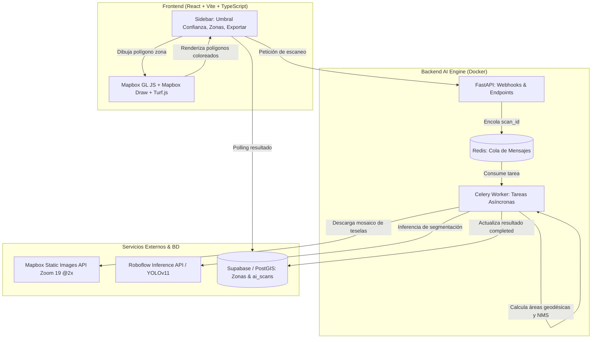

# Estado del Proyecto: AI Greenhouse Detection

> **Fecha de actualización:** Octubre 2026  
> **Estado general:** Modelo YOLOv11 V5 entrenado con éxito (mAP@50 subió de 65.1% a 82.0%, Precisión de 61.5% a 81.1%), desplegado en `ai-engine/config.py`. Inferencia geoespacial de alta resolución con solapamiento 25%, filtro de bordes y NMS por contención. Panel interactivo en React completamente funcional.

---

## 🎯 Objetivo del Proyecto
Plataforma SaaS / SIG orientada a catastros rurales y cooperativas agrícolas para detectar automáticamente **invernaderos plásticos** (`invernadero_plastico`) a partir de ortofotos satelitales satelitales de alta resolución (Mapbox Zoom 19 @2x) mediante un modelo de **Segmentación por Instancias (YOLOv11 Nano)** entrenado sobre el Valle de Ararat (Armenia), calculando el área real en metros cuadrados ($m^2$) y hectáreas ($ha$), porcentaje de cobertura plástica, edición manual interactiva (Human-in-the-Loop) y reportes en Excel.

---

## 🏗️ Arquitectura del Sistema

### Componentes Principales:
1. **Frontend (`frontend/`)**:
   - React 18, Vite, TypeScript, Mapbox GL JS, `@mapbox/mapbox-gl-draw`.
   - Modos de dibujo: Polígono cerrado punto a punto (`draw_polygon`), Rectángulo rápido (`draw_rectangle`), Marcador de distancias/regla y textos.
   - Cálculo geodésico exacto en cliente con `@turf/area` y `@turf/bbox`.
   - Coloreado por confianza: Verde (>80%), Amarillo (50-80%), Naranja (<50%), Manual (100%).
   - Exportación de auditoría a Excel (`xlsx`).

2. **AI Engine (`ai-engine/`)**:
   - `tasks.py`: Orquestador Celery. Calcula centroides de cuadrícula satelital sobre la zona, descarga tiles Mapbox a 512px @2x, procesa inferencia Roboflow YOLOv11-nano, transforma máscaras de píxeles a coordenadas geodésicas WGS84, aplica NMS inter-teselas y persiste en PostGIS.
   - `config.py`: Token de Mapbox, llaves de Roboflow, versión del modelo (`ROBOFLOW_VERSION = 4`), variables de entorno.
   - `main.py`: FastAPI webhook receiver en puerto `5000`.
   - `docker-compose.yml`: Servicios `api`, `worker` (Celery) y `redis`.

3. **Base de Datos (Supabase / PostGIS)**:
   - Tabla `zones`: Almacena geometrías vectoriales del perímetro delimitado por el usuario, hectáreas y porcentaje de lona requerido.
   - Tabla `ai_scans`: Almacena estado (`processing` / `completed`), total de área detectada ($m^2$), conteo de invernaderos y el FeatureCollection completo en `result_geojson`.

---

## 📈 Hitos y Mejoras Recientes Completadas

### 1. Corrección Crítica de Escala Satelital y Georreferenciación (Opción A)
- **Problema previo:** Los cuadros detectados aparecían gigantes, desplazados o en medio de la tierra vacía.
- **Causa raíz identificada:** Mapbox entrega imágenes a **512px de resolución por tesela**, pero el código heredado utilizaba la constante de 256px (`156543 / 2^zoom` en vez de `78271.51696402048 / 2^zoom`). Además, faltaba compensar la distorsión cilíndrica de latitud en el área ($\cos^2(\text{lat})$).
- **Solución implementada:**
  - `logical_res = 78271.51696402048 / (2 ** zoom)`
  - `physical_res = logical_res / 2` (0.0746 m/px a Zoom 19 @2x).
  - Compensación geodésica del área en $m^2$: `pixel_area * (physical_res ** 2) * (cos_lat ** 2)`.
  - Cuadrícula de teselas satelitales optimizada con paso angular exacto (`step_lon`, `step_lat`) garantizando cobertura 100% sin puntos ciegos.

### 2. Entrenamiento y Despliegue de YOLOv11 Nano (Versión 4)
- **Dataset:** 1,658 imágenes satelitales de alta resolución de zonas productivas de Armenia (Masis, Artashat, Ararat, Gai, Khoronk, Geghanist, Jrarat, etc.).
- **Etiquetado:** Segmentación poligonal de invernaderos plásticos tipo túnel y naves agrícolas.
- **Rendimiento:**
  - **mAP@50:** 65.1%
  - **Precisión:** 61.5%
  - **Recall:** 66.5%
- Configurado en `ai-engine/config.py`: `ROBOFLOW_VERSION = 4`.

### 3. Filtro Dinámico de Confianza en Tiempo Real (Sidebar)
- Slider reactivo (30% a 90%) en `Sidebar.tsx`.
- Filtrado inmediato en `App.tsx` usando `useMemo`: recalcula instantáneamente el conteo de invernaderos y la suma total de $m^2$ sin realizar llamadas a la red.

### 4. Delineado Manual Punto por Punto y Rectángulo
- Enriquecimiento "Human-in-the-Loop" para agregar invernaderos no detectados por la IA:
  - Botón selector en pantalla: **Polígono (unión de puntos con auto-cierre)** o **Rectángulo rápido**.
  - Asignación de 100% de confianza, cálculo automático de superficie con Turf.js y conservación permanente frente al slider de confianza.

### 5. Exportación Detallada a Excel
- Generación de reportes XLSX con dos pestañas:
  - **Resumen:** Zona, hectáreas escaneadas, total de invernaderos, área cubierta ($m^2$), estimación de lona requerida.
  - **Detalle de Invernaderos:** Desglose individual de cada estructura con su ID, nivel de confianza (o Manual) y superficie en $m^2$.

---

---

## 🔍 Solución Aplicada al Bug de Eliminación de Invernaderos

### Correcciones Implementadas:
1. **Rebote de Eventos DOM (Event Bubbling) y Popup Fantasma Resuelto:**
   - En `Map.tsx`, se agregaron `e.stopPropagation()` y `e.preventDefault()` en el click listener de `btn-del-det`.
   - Se añadieron interceptores `stopPropagation` en `click`, `mousedown`, `mouseup` y `touchstart` sobre `popupNode` y en el contenedor raíz `popup.getElement()`.
   - Se remueve cualquier popup activo previo de manera determinista al refrescar `scanResult`.
2. **Normalización Estricta de IDs (String Consistency):**
   - En `App.tsx`, `ensureFeatureIds` normaliza de manera consistente cada ID como `String(id)` tanto en la raíz de la Feature como en `properties.id`.
   - `handleDeleteDetection` castea y compara estrictamente `fid !== targetId` en formato string.
   - Las adiciones manuales generan un `newId` único sincronizado entre `f.id` y `f.properties.id`.
3. **Detecciones Duplicadas por Solape de Teselas Satelitales (NMS Reforzado):**
   - Se ajustó el umbral de NMS IoU de `0.5` a `0.35` en `ai-engine/tasks.py`.
   - Se normalizan los IDs resultantes como cadenas limpias `det_1`, `det_2`, etc.
   - Contenedor `ai-engine-worker-1` reiniciado y operativo.
4. **Desbloqueo de Actualización de Capa GeoJSON:**
   - Se eliminó la guardia bloqueante `isStyleLoaded()` del `useEffect` de `scanResult`. Si la fuente `ai-detections-source` ya existe en el mapa, `source.setData()` se dispara de inmediato aunque Mapbox esté cargando teselas satelitales secundarias. Si la fuente aún no existe, se suscribe al evento `load`.
5. **Persistencia de Ediciones en Base de Datos:**
   - `handleUpdateZone` en `App.tsx` ahora actualiza o inserta automáticamente en la tabla `ai_scans` las eliminaciones y adiciones manuales de la zona activa al guardar cambios.

---

## 🚀 Mejoras Aplicadas al Pipeline de Detección (Post-Diagnóstico)

1. **Aumento del Solapamiento de Teselas Satelitales (25% overlap):**
   - Se ajustó el paso angular `step_w` y `step_h` a `0.75` (antes `0.9`). Esto garantiza que invernaderos de más de 100m no queden seccionados en las fronteras entre fotos de Mapbox.
2. **Ampliación de Límite de Aspect Ratio (hasta 30):**
   - Se incrementó el filtro de relación de aspecto de `12` a `30` en `ai-engine/tasks.py`. Esto previene el descarte erróneo de naves agrícolas y túneles largos y angostos (ej. 150m x 8-10m).
3. **Filtro de Contención en NMS (Anti-Escaleritas):**
   - Se implementó la métrica `calculate_iou_and_containment`. Si una sub-detección menor está contenida en más del 50% dentro de otra nave o comparte un IoU $> 0.35$, se descarta para evitar la acumulación de cajitas repetidas en diente de sierra.
4. **Umbral de Inferencia y Slider en Frontend:**
   - Inferencia en Celery captura desde un 25% de confianza (`pred.confidence < 0.25`).
   - El slider de confianza inicial en React arranca en **40%** (antes 50%) para mostrar una cobertura inicial más completa.
5. **Transición a Zoom 18 Satelital (300m x 300m por baldosa):**
   - Se ajustó `ZOOM = 18` en `ai-engine/tasks.py`. Esto cuadruplica el campo visual de cada tesela satelital, permitiendo que baterías completas de más de 120m quepan enteras en una sola captura sin cortarse por los bordes.
   - Reduce las teselas por zona de 84 a 24 (el tiempo total de escaneo bajó de 112s a **22s**).
6. **Fusión Espacial de Detecciones Contiguas (Spatial Stitching con `unary_union`):**
   - Se implementó análisis de componentes conexos con `networkx` y `shapely.ops.unary_union` para soldar automáticamente piezas que se solapen entre teselas contiguas antes del NMS final. Elimina el efecto de "romboides" o cortes diagonales en las fronteras entre fotos.

---

## 📊 Evolución de Modelos (Roboflow YOLOv11 Nano Segmentation)

| Métrica | Versión 4 (Dataset viejo / tiras) | Versión 5 (Dataset re-etiquetado / bloques) | Mejora Absoluta |
| :--- | :---: | :---: | :---: |
| **mAP@50** | 65.1% | **82.0%** | **+16.9%** 🚀 |
| **Precision** | 61.5% | **81.1%** | **+19.6%** 🎯 |
| **Recall** | 66.5% | **75.9%** | **+9.4%** |
| **F1 Score** | 63.9% | **78.4%** | **+14.5%** |
| **Créditos** | 0.52 | **0.51** | - |

---

## 🛠️ Comandos Útiles para el Entorno

- **Levantar Frontend:** `cd frontend && npm run dev` (Corre en `http://localhost:5173`)
- **Compilar Frontend:** `cd frontend && npm run build`
- **Levantar Backend / Contenedores:** `cd ai-engine && docker compose up -d`
- **Reiniciar Worker de Celery:** `cd ai-engine && docker compose restart worker`
- **Logs de Tareas Celery:** `docker logs -f ai-engine-worker-1`
- **Verificar Supabase Local:** Puertos `8000` (Kong Gateway), `54321` (API), `54322` (Postgres).

